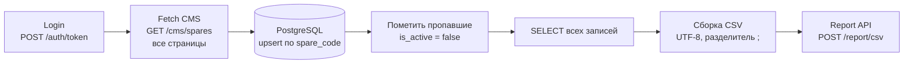

# Integration: синхронизация запчастей CMS → историческая БД → Report API

Учебный проект по курсу «Интеграция систем, разработка интеграционных сервисов».
Интеграционное приложение на **n8n** синхронизирует данные между тремя системами:

1. **CMS** хранит только текущий остаток деталей на складе и не хранит историю.
2. **БД исторических данных** (PostgreSQL, реализована в этом проекте) хранит все детали, включая вышедшие из оборота, и обновляет данные при их изменении в CMS.
3. **Report API** принимает CSV-файл с текущим состоянием исторической БД.

CMS и Report API эмулируются учебным API: `http://77.67.89.207:8080` (Swagger UI: `/swagger-ui/index.html`).

## Архитектура



### Поток 1. CMS → БД
1. Получаем токен (`POST /auth/token`).
2. Забираем детали из `GET /cms/spares` страницами по 10 штук (`page` с 0, `size` максимум 10) до первой пустой страницы. Эндпоинт защищён BasicAuth.
3. Добавляем новые детали и обновляем существующие по ключу `spare_code` (upsert), записываем время `last_seen_at`.
4. Детали, которых нет в текущей выгрузке, помечаем `is_active = false`. Из БД они **не удаляются**, так сохраняется история.

### Поток 2. БД → CSV → Report API
1. Выбираем из БД **все** записи, включая неактивные.
2. Собираем CSV: без заголовка, разделитель `;`, перенос строки `\n`, UTF-8. Колонки:
   `spareCode;spareName;spareDescription;spareType;spareStatus;price;quantity;updatedAt`.
3. Отправляем файл в `POST /report/csv` с заголовками `Authorization: Bearer <token>` и `Content-Type: text/csv`.

Ответ Report API содержит `studentId`, `result`, `lastSyncAt`, `lastSyncMessage` и `period`.

## Узлы workflow

| Узел | Назначение |
|---|---|
| Manual Trigger | ручной запуск (при желании заменяется на Schedule Trigger) |
| Config | адрес API, логин и пароль |
| Create Table | создаёт таблицу `spares`, если её нет |
| Login | получает токен, пробует `/auth/login` и `/auth/token` |
| Fetch CMS | проходит все страницы CMS, убирает дубли по коду, формирует записи для БД |
| Upsert Spares | вставка или обновление по `spare_code` |
| Mark Missing Inactive | помечает неактивными детали, которых нет в выгрузке |
| Select All | выбирает все записи для отчёта |
| Build CSV | собирает CSV по правилам формата |
| Send to Report API | отправляет CSV с Bearer-токеном |

## Принятые решения

- **Цена и дата хранятся строками** так, как пришли из CMS. Это исключает потери точности и расхождения форматов при проверке «точности данных».
- **Историчность.** Записи не удаляются, а получают `is_active = false`, при этом `first_seen_at` и `last_seen_at` показывают жизненный цикл детали.
- **Защита от пустой выгрузки.** Если CMS вернул 0 деталей (сбой), синхронизация прерывается, чтобы не пометить все детали неактивными.
- **Все страницы.** Пагинация идёт до пустой страницы, а не до первой неполной, поэтому не теряются данные.
- **Свежий токен на каждый запуск.** Токен живёт недолго, поэтому запрашивается в начале каждого запуска.

## Структура репозитория

```
integration/
├── README.md
├── n8n-workflow-spares-sync.json   # workflow для импорта в n8n
├── schema.sql                      # схема таблицы spares
├── docker-compose.yml              # n8n + PostgreSQL для локального запуска
└── .gitignore
```

## Запуск

### Вариант А: через Docker
```bash
docker compose up -d
```
n8n откроется на http://localhost:5678, PostgreSQL на `localhost:5432` (база `spares`, пользователь `app`, пароль `app`).

### Вариант Б: без Docker
1. Установите Node.js (LTS) и PostgreSQL.
2. Создайте базу `spares` (например, в pgAdmin).
3. Запустите n8n: `npx n8n` и откройте http://localhost:5678.

### Настройка n8n
1. **Credentials → Create credential → Postgres**:
   - Docker: host `postgres`, database `spares`, user `app`, password `app`, port `5432`.
   - Без Docker: host `localhost`, database `spares`, ваш пользователь и пароль, port `5432`.
2. Создайте workflow и выберите **Import from file** → `n8n-workflow-spares-sync.json`.
3. В узле **Config** впишите свои логин и пароль. **Не коммитьте их в репозиторий**: перед экспортом workflow верните плейсхолдеры.
4. В узлах **Create Table**, **Upsert Spares**, **Mark Missing Inactive** и **Select All** выберите созданную Postgres-credential.
5. Нажмите **Execute workflow**. Результат смотрите в выводе последнего узла.

### Проверка
```sql
SELECT count(*) FROM spares;
SELECT count(*) FROM spares WHERE is_active = false;
```
Оценку можно посмотреть в Swagger UI: `GET /students/{studentId}/results`.

## Типичные проблемы

| Симптом | Причина и решение |
|---|---|
| 403 при получении токена | неверные логин или пароль |
| 401 от CMS | неверные данные BasicAuth |
| 401 от Report API | истёк токен, запустите workflow заново |
| В БД меньше деталей, чем в CMS | проверьте, что пагинация дошла до конца |
| Ошибка подключения к Postgres | проверьте, что сервер запущен, а host и пароль в credential верные |

## Безопасность

- В репозитории нет реальных логинов, паролей и токенов, только плейсхолдеры.
- Данные для подключения к учебному API хранятся локально в n8n.
- Пароли в `docker-compose.yml` годятся только для локальной разработки.
